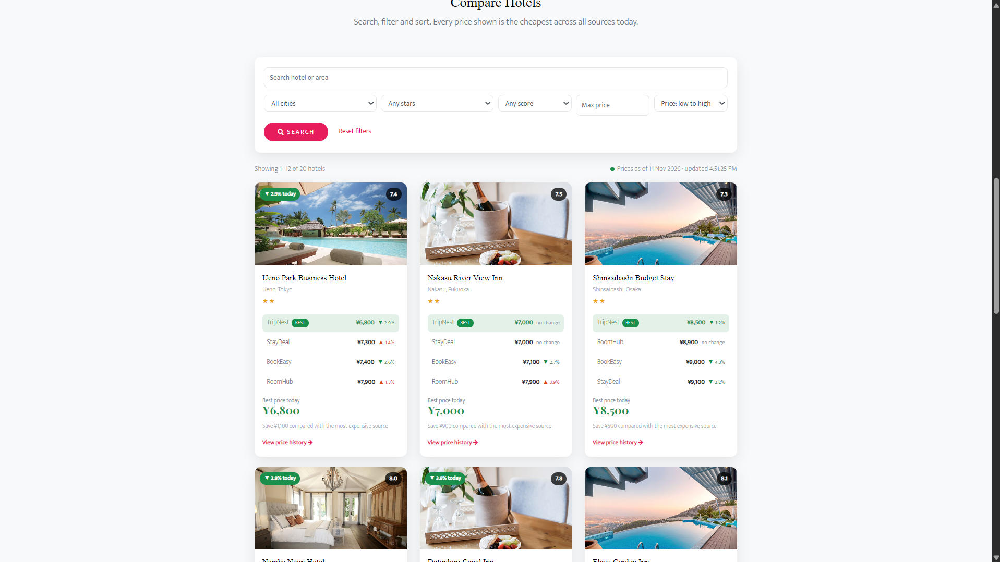
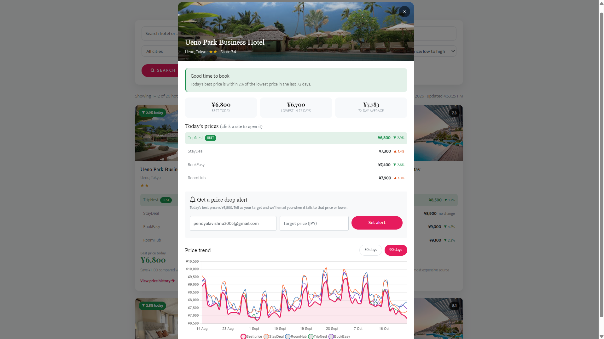
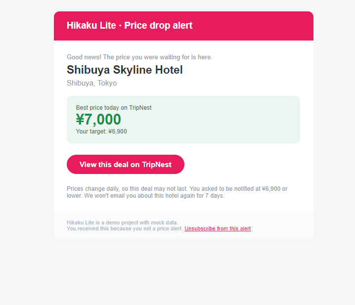
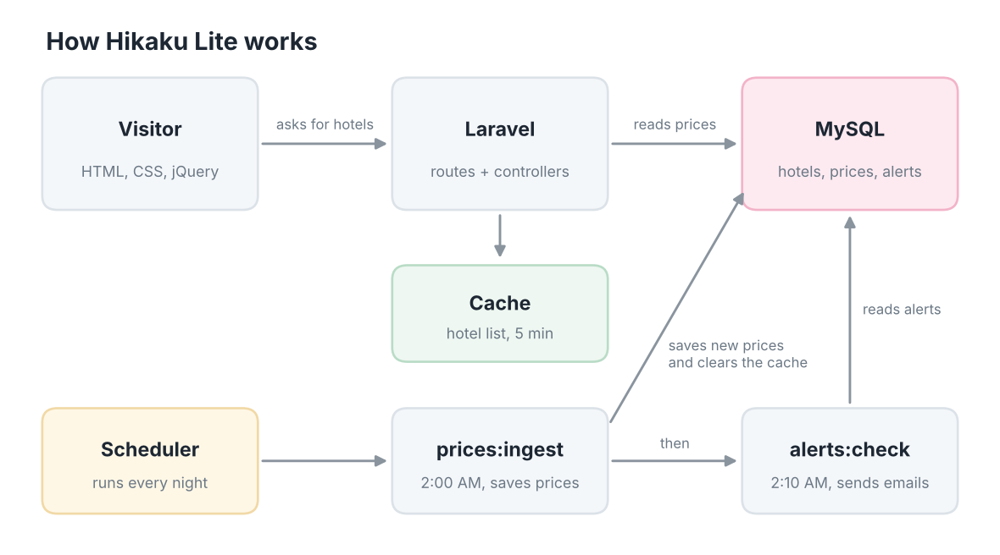
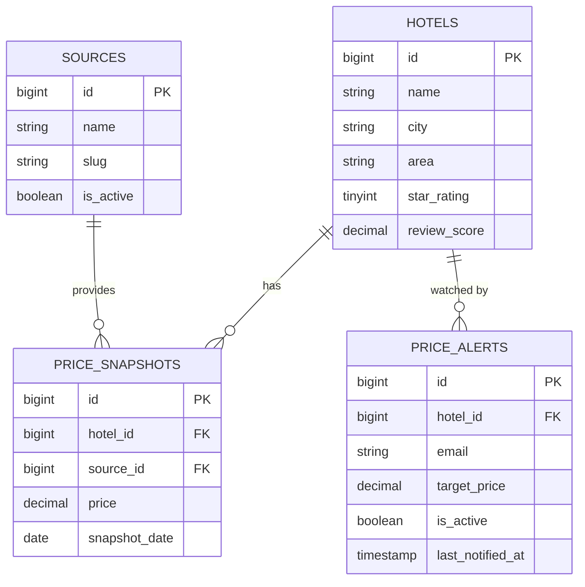
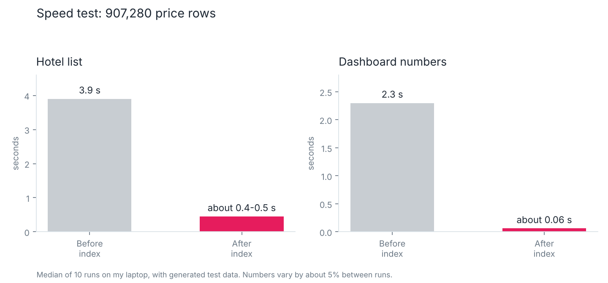

# Hikaku Lite

A hotel price comparison website. It shows the price of the same hotel on several booking sites, marks the cheapest one, and shows a price history chart so a visitor can decide whether to book now or wait. Visitors can also set a target price and get an email when it drops.


> **About the data:** all prices are sample data. Real booking sites only share prices with approved business partners, so the four sources (StayDeal, RoomHub, TripNest and BookEasy) are simulated. The code reads prices from a `sources` table, so a real source can be added the same way.

## Project information

| | |
|---|---|
| Type | Personal project |
| Team size | Individual (1 developer) |
| My role | Database design, backend, frontend and testing |
| Started | October 2026 |
| Status | In progress |

## Contents

- [Features](#features)
- [Screenshots](#screenshots)
- [Tech stack](#tech-stack)
- [Architecture](#architecture)
- [Database](#database)
- [API](#api)
- [Scheduled jobs](#scheduled-jobs)
- [Performance](#performance)
- [Security](#security)
- [Getting started](#getting-started)
- [Project structure](#project-structure)
- [Roadmap](#roadmap)
- [Credits](#credits)

## Features

- Search by hotel name or area, filter by city, stars, review score and price, sort five ways, and page through results.
- Every hotel card shows the price on each site, marks the cheapest one, and shows the change since yesterday.
- A detail popup with a 30 or 90 day price chart and a short "book now or wait" recommendation.
- A dashboard with live counters: hotels tracked, sources, average best price and price drops today.
- Prices refresh every 60 seconds without reloading the page.
- Price drop alerts: an email is sent when the best price reaches the visitor's target, with a one-click unsubscribe link.
- Mobile-first layout that works on phones and computers.

## Screenshots

| Hotel cards | Hotel detail |
|---|---|
|  |  |



## Tech stack

| Layer | Technology |
|---|---|
| Backend | PHP 8.3, Laravel 13 (routing, Eloquent, migrations, scheduler, mail, cache) |
| Database | MySQL 8.4 |
| Frontend | HTML, CSS, JavaScript, jQuery 3.2, Chart.js |
| Design | Villa template by Colorlib (Bootstrap 4, AOS) with custom styles |
| Tooling | Laragon, Composer, Git |

## Architecture



A scheduled job saves new prices every night and clears the cache. A second job then checks the price alerts and sends emails. When a visitor opens the site, jQuery requests hotels from the Laravel API, which answers from the cache or from MySQL.

## Database



`price_snapshots` has a unique key on `(hotel_id, source_id, snapshot_date)`, so a price can never be saved twice for the same day, and indexes for price-history lookups and for the "latest day" queries.

## API

| Method | Endpoint | Description |
|---|---|---|
| GET | `/api/hotels` | Hotel list with search, filters, sorting, paging and the price on every site |
| GET | `/api/hotels/{id}` | One hotel: 90-day history, statistics and the book-or-wait recommendation |
| GET | `/api/stats` | Numbers for the dashboard counters |
| POST | `/api/alerts` | Create or update a price drop alert (limited to 10 requests per minute) |
| GET | `/alerts/{id}/unsubscribe` | One-click unsubscribe, protected by a signed URL |
| GET | `/go/{hotel}/{source}` | Click-out page for a (simulated) booking site |

Query parameters for `/api/hotels`: `q`, `city`, `stars`, `min_price`, `max_price`, `min_score`, `sort` (`price_asc`, `price_desc`, `rating`, `stars`, `name`), `per_page` and `page`.

## Scheduled jobs

| Time | Command | What it does |
|---|---|---|
| 02:00 | `prices:ingest` | Saves the new day's prices and clears the hotel list cache |
| 02:10 | `alerts:check` | Emails visitors whose target was reached (at most once every 7 days per alert) |

Both run through the Laravel scheduler, do not overlap with themselves, and write a log under `storage/logs/`. `alerts:check --dry-run` shows what would be sent without sending anything.

## Performance

To see how the site behaves with a lot of data, I wrote a command that adds about 900,000 test price rows (907,280 in total) and another that measures each request.



| Request | Before the index | After the index |
|---|---|---|
| Hotel list | about 3.9 s | about 0.4 to 0.5 s |
| Dashboard numbers | about 2.3 s | about 0.06 s |

**Method:** one warm-up run, then 10 timed runs, and the median is reported. I timed every SQL query, checked how MySQL reads the data with `EXPLAIN`, and added a composite index that starts with `snapshot_date`. The hotel list is also cached for 5 minutes. The cache key contains a version number that the nightly job changes, so new prices show up straight away.

**Limits:** the numbers come from one laptop with generated data, and they move by about 5% between runs. A second change that removed a table join from the main query made no measurable difference, so I did not count it as an improvement.

## Security

- All input is validated on the server, and text is escaped before it is shown on the page.
- The alert form is limited to 10 requests per minute for each visitor.
- Unsubscribe links are signed, so they cannot be guessed or changed.
- Settings and secrets stay in `.env`, which is not committed.

## Getting started

Requirements: PHP 8.3 or newer, Composer and MySQL 8.

```bash
git clone https://github.com/Meghanamahanandareddy/hikaku-lite.git
cd hikaku-lite
composer install
cp .env.example .env        # on Windows: copy .env.example .env
php artisan key:generate
```

Create an empty database called `hikaku_lite`, then set these values in `.env`:

```
DB_CONNECTION=mysql
DB_HOST=127.0.0.1
DB_PORT=3306
DB_DATABASE=hikaku_lite
DB_USERNAME=root
DB_PASSWORD=
MAIL_MAILER=log
```

Create the tables, add the sample data and start the server:

```bash
php artisan migrate --seed
php artisan serve
```

Open http://127.0.0.1:8000. With `MAIL_MAILER=log`, emails are written to `storage/logs/laravel.log` instead of being sent.

Useful commands:

```bash
php artisan prices:ingest              # save a new day of prices
php artisan alerts:check --dry-run     # show which alerts would be emailed
php artisan schedule:work              # run the scheduled jobs locally
php artisan perf:load --hotels=2500    # add about 900,000 test price rows
php artisan perf:load --clear          # remove the test data
php artisan perf:bench --label=run1    # measure request speed
php artisan cache:clear                # run this after reseeding or loading test data
```

## Project structure

```text
app/
  Console/Commands/    prices:ingest, alerts:check, perf:load, perf:bench, perf:queries
  Http/Controllers/    HotelController, StatsController, AlertController, PartnerController
  Mail/                PriceDropAlert
  Models/              Hotel, Source, PriceSnapshot, PriceAlert
database/
  migrations/          the four tables and the price index
  seeders/             sources, hotels and 90 days of prices
public/
  css/hikaku.css       custom styles
  js/                  hotels.js (list, popup, chart, alerts), dashboard.js (counters)
resources/views/       hotels, partner, unsubscribed, emails/price-drop
routes/                web.php (routes), console.php (schedule)
docs/images/           screenshots and diagrams
```

## Roadmap

- [x] Database design, migrations and seeders
- [x] Nightly price job and price alert job
- [x] Search, filters, sorting and dashboard
- [x] Price chart and book-or-wait recommendation
- [x] Price drop emails with unsubscribe link
- [x] Indexing, caching and performance measurements
- [ ] Deploy on AWS (EC2 and RDS)
- [ ] Send alert emails with Amazon SES
- [ ] Serve static files with S3 and CloudFront
- [ ] Automated tests

## Credits

Built by [@Meghanamahanandareddy](https://github.com/Meghanamahanandareddy).

The page design is based on [Villa](https://colorlib.com) by Colorlib, licensed under [CC BY 3.0](https://creativecommons.org/licenses/by/3.0/). Charts use [Chart.js](https://www.chartjs.org/).
